# 工作序记 · WorkOrderNote

任务、记事、日历、课程表与倒计时，一体的个人提醒应用。

单机部署、数据全在本地；也可以两台机器自动同步。界面同时适配桌面与手机，
支持装成 PWA 或打包安卓客户端。

**下载**：[GitHub Releases](https://github.com/magicindex/workordernote/releases) · 最新版本 v0.43.1

**国内仓库（Gitea）**：<https://gitea.topzero.cn:10241/cyberzero/WorkOrderNote>

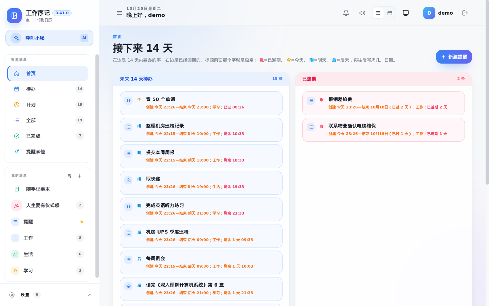

## 功能

| 模块 | 说明 |
| --- | --- |
| **任务 / 记事** | 任务需要确认完成；记事只作记录，保存即归档、不发通知 |
| **提醒** | 到点提醒；站内、邮件、短信、飞书、QQ、钉钉多渠道，可分别绑定接收人 |
| **重复规则** | 每天 / 每周 / 每月 / 每年，支持农历（生日、中秋、春节等） |
| **列表视图** | 今天、计划、全部、已完成；行尾显示剩余或已逾期时长，不足 24 小时转红 |
| **首页看板** | 「接下来 14 天」与「已逾期」两列，打开即知轻重缓急 |
| **日历** | 月历同时显示公历、农历、节气与节日 |
| **打印** | 日历整月打印，或切换列表按行打印；可调方向、字号、标题与打印列 |
| **课程表** | 按周几排课，一张表一个人；非编辑态只读，进编辑态才铺空节次、显示添加入口；手机「清单」弹层可直达 |
| **人生要有仪式感** | 生日、纪念日、考试倒计时卡片；公历、农历分两行同显；多种配色、金属色与背景图 |
| **信用卡账单** | 账单日、还款日、免息期与本期金额，接近还款日自动变色；「更多」点击展开菜单 |
| **数据备份** | 每天定时备份整库与上传文件到本机目录和/或 WebDAV，可保留 N 份；支持一键恢复 |
| **双机同步** | 清单、任务、记事、完成记录、账单、课程表、个人偏好、站点设置；账号密码与渠道凭据不同步 |
| **AI 小秘** | 接 Ollama 或任意 OpenAI 兼容接口；可查日程、写周报、把一句话变成待办 |

## 界面一览

### 待办与计划

列表按日期分组，行尾直接显示「剩余 1 天 2 小时」或「已逾期 22 小时」；
进入 24 小时内自动转红，逾期与今天分成不同色带。

| 待办 | 计划 |
| --- | --- |
| 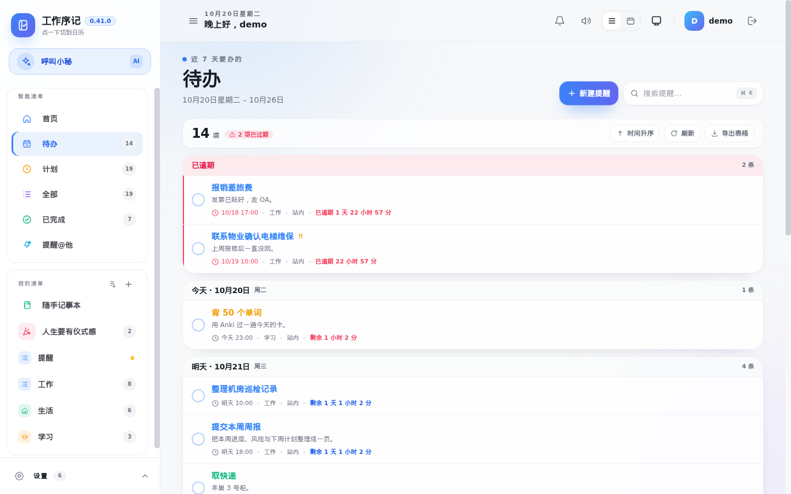 |  |

| 全部 | 已完成 |
| --- | --- |
| 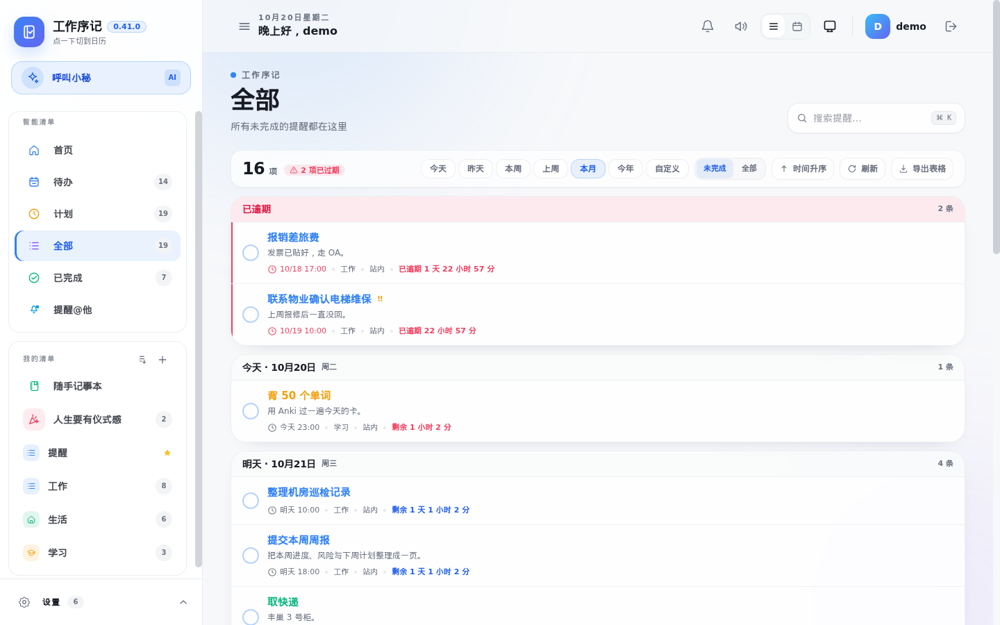 |  |

### 日历与课程表

月历格子同时标注农历、节气与节日，可切换周视图；课程表按周几铺课，
课程与课外活动分开标色，支持打印。

| 日历 | 课程表 |
| --- | --- |
| 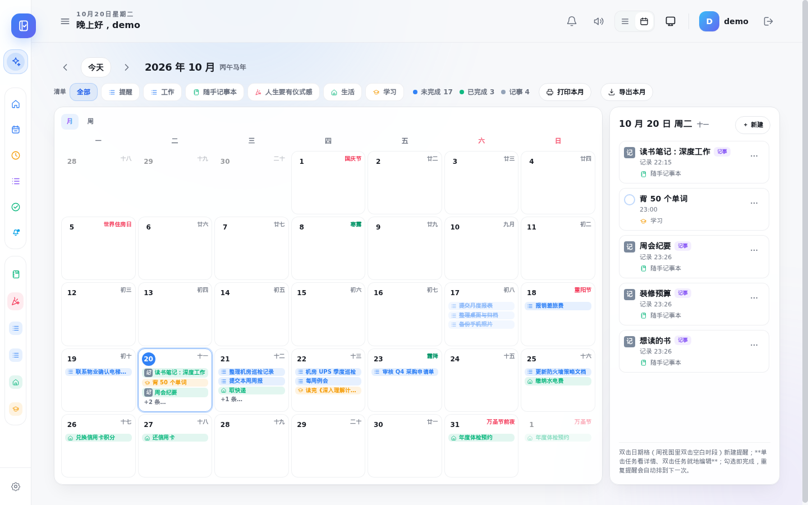 | 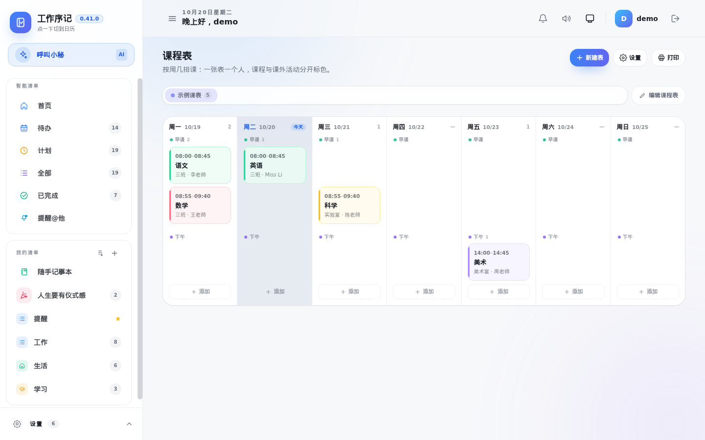 |

### 打印预览

日历可整月打印，也可切换成「列表」按行打印；两种模式都先给预览，
可调纸张方向、字号、标题、说明，以及要打印的列。

| 日历打印 | 列表打印 |
| --- | --- |
| 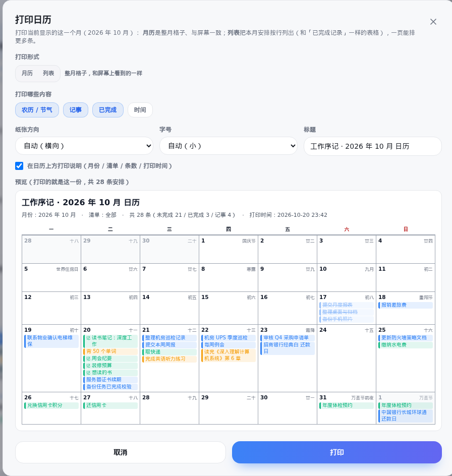 | 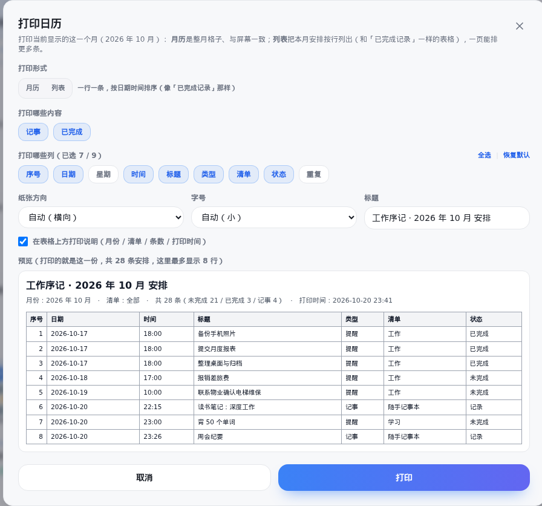 |

### 记事与仪式感

随手记事本只记录、不需要完成；「人生要有仪式感」把生日、纪念日、考试
做成倒计时卡片，支持每年循环与农历。

| 随手记事本 | 人生要有仪式感 |
| --- | --- |
|  |  |

### 信用卡账单

一个栏目装多张卡：账单日、还款日、额度、免息期与本期金额都在卡面上；
临近还款日时卡面颜色会由黄转橙、再转红，支持标记已还与修改本期金额。
手机端卡片改为单列，左右滑动查看。

| 桌面端 | 手机端 |
| --- | --- |
|  |  |

### 新建与编辑提醒

快速面板支持「任务 / 记事」、今天 / 明天 / 本周末、重复规则、优先级与清单；
点开任意一条可改日期、农历循环、过期提醒频率和通知方式。

| 新建提醒 | 提醒详情 |
| --- | --- |
|  | 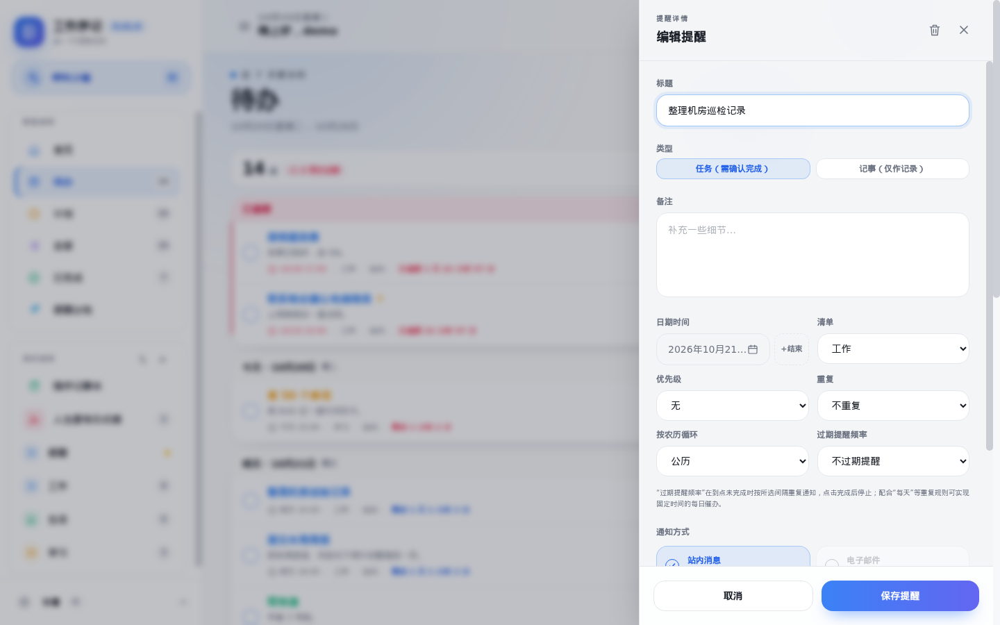 |

### 搜索与通知

顶栏搜索直接过滤当前视图；通知中心汇总到期、逾期、渠道失败与「提醒@他」
回执；通知方式里分别配置站内、邮件、短信、飞书、QQ、钉钉。

| 搜索 | 通知中心 |
| --- | --- |
| 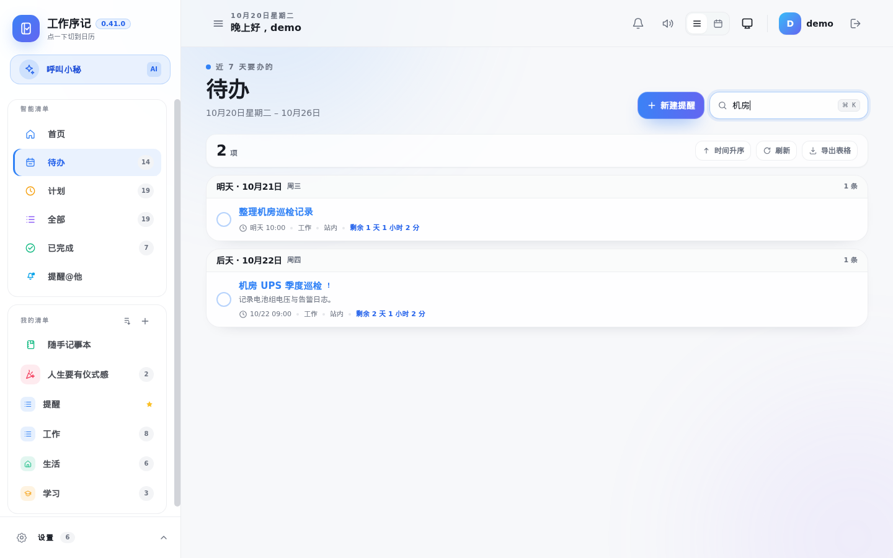 | 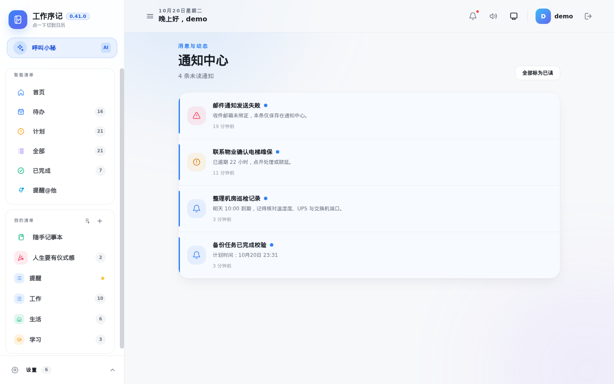 |

| 通知方式 | 提醒@他 |
| --- | --- |
|  | 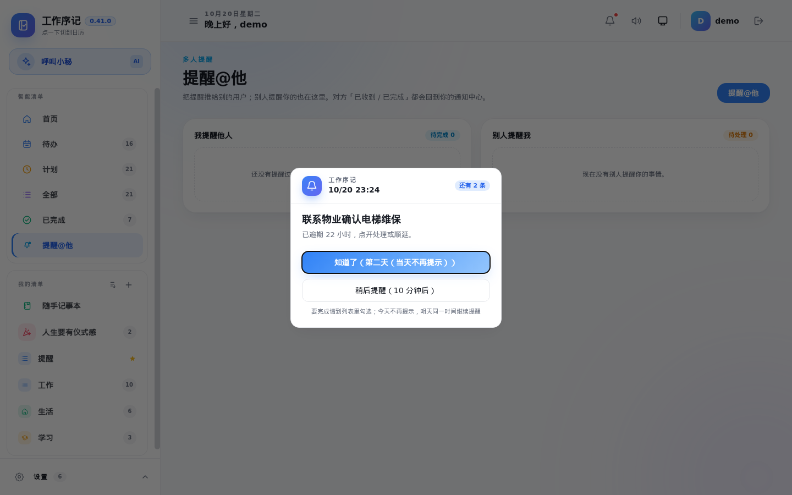 |

### 偏好设置

默认首页、任务过期时间与宽限、免打扰时段、提醒频率、主题与各栏目开关，
都按账号保存；系统级配置在「系统配置」里，仅管理员可改。


### 手机端

手机浏览器直接可用，底部为待办 / 计划 / 清单 / 通知 / 方式五个入口，
也支持添加到主屏当 PWA 使用。

| 手机首页 | 手机待办 |
| --- | --- |
| 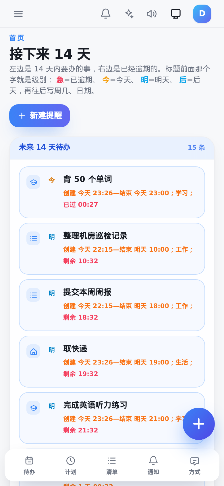 |  |

## 快速开始

### Docker Compose

使用预构建镜像，无需克隆源码：

```bash
mkdir -p workordernote && cd workordernote
curl -fsSLO https://raw.githubusercontent.com/magicindex/workordernote/main/docker-compose.yml
docker compose up -d
```

打开 <http://localhost:8906>，首次启动后注册第一个账号（即管理员）。

也可以克隆仓库、从源码构建：

```bash
git clone https://github.com/magicindex/workordernote.git
cd workordernote
docker build -t ghcr.io/magicindex/workordernote:0.43.0 .
docker compose up -d
```

数据落在命名卷 `workordernote-data`；如需指定宿主机目录，改成
`- ./data:/app/data` 并确保容器用户对目录可写（镜像内以 uid 1000 运行）。

升级：修改 compose 里的镜像 tag 后执行 `docker compose pull && docker compose up -d`。

### 直接运行二进制

```bash
make build          # 前端 + 后端
./server/smallgo -data-dir ./data -web-dir ./server/static/dist
```

需要 Go 1.26（CGO，SQLite）与 Node 20+。

## 配置

首次登录后，侧栏「设置」里可以调整：

- **偏好设置**：默认首页、默认清单、任务过期时间与宽限、免打扰时段、提醒频率、AI 提示词与小秘名字
- **系统配置**：站点标题、访问控制、通知渠道、AI 服务、数据备份、双机同步

所有个人偏好按账号隔离；系统配置仅管理员可改。

### AI

在「系统配置 → AI 服务」填 Ollama 地址（如 `http://127.0.0.1:11434/v1`）或任意
OpenAI 兼容服务的 Base URL、模型与密钥。不配置时应用完全可用，只是没有对话入口。

### 备份

「系统配置 → 数据备份」可设每天几点、落本机目录与 WebDAV、保留份数；
「立即备份」可随时手动打一份。备份包含数据库与上传文件，不包含日志。
「数据恢复」可列出本机备份，或上传别处保存的 `.tar.gz`；恢复前会自动生成
一份 `...-before-restore.tar.gz` 安全备份，确认后覆盖整库与上传文件。

### 双机同步

两台都升级到 0.39 以上，在「系统配置 → 双机同步」里互填地址与同一个通信令牌，
选择双向或单向、自动同步间隔。账号按用户名配对，不存在的账号不会自动创建。

## 安全

- 数据默认只存本机，不上传任何第三方
- 密码以 bcrypt 哈希保存；同步与接口密钥不随同步外发
- 公网访问请置于 HTTPS 反向代理之后，并设置强密码
- 应用内的备份文件包含数据库，请按敏感数据保管

## 目录

```
server/         Go 后端（Gin + GORM + SQLite）
web/            Vue 3 + TypeScript 前端
android-shell/  安卓 WebView 壳
scripts/        构建与打包脚本
docs/           截图
```

## 许可与出处

本项目是开源项目 [TechFunWay/reminders](https://github.com/TechFunWay/reminders)
（MIT 许可）的衍生作品，原项目著作权与出处均予保留，详见 [NOTICE](NOTICE)。

以 MIT 许可发布，见 [LICENSE](LICENSE)。
