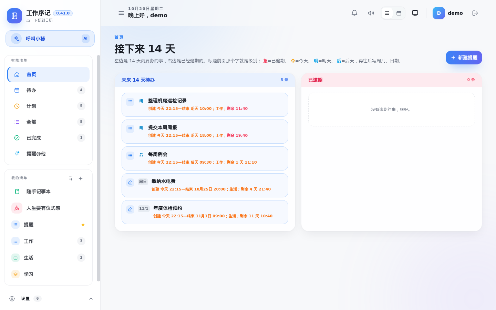
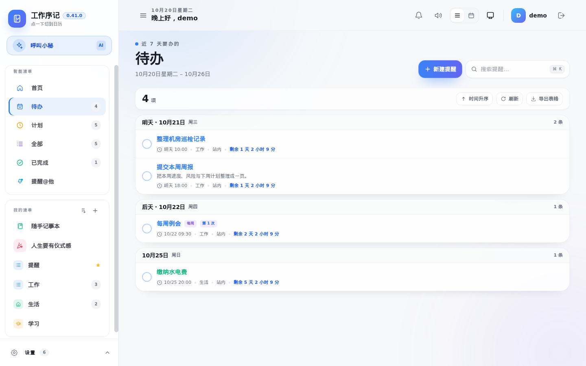
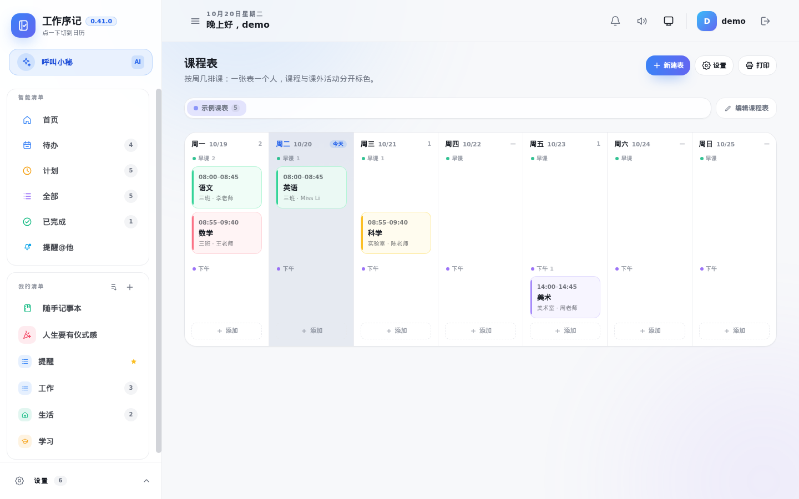
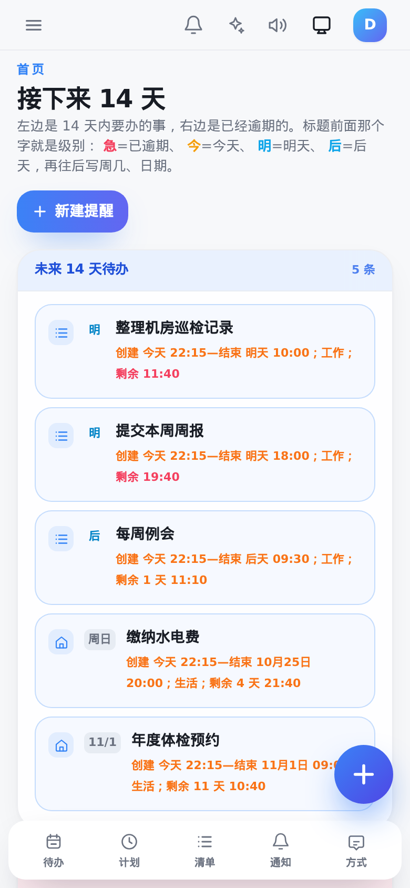

# 工作序记 · WorkOrderNote

任务、记事、日历、课程表与倒计时，一体的个人提醒应用。

单机部署、数据全在本地；也可以两台机器自动同步。界面同时适配桌面与手机，
支持装成 PWA 或打包安卓客户端。



## 功能

| 模块 | 说明 |
| --- | --- |
| **任务 / 记事** | 任务需要确认完成；记事只作记录，保存即归档、不发通知 |
| **提醒** | 到点提醒；站内、邮件、短信、飞书、QQ、钉钉多渠道，可分别绑定接收人 |
| **重复规则** | 每天 / 每周 / 每月 / 每年，支持农历（生日、中秋、春节等） |
| **列表视图** | 今天、计划、全部、已完成；行尾显示剩余或已逾期时长，不足 24 小时转红 |
| **首页看板** | 「接下来 14 天」与「已逾期」两列，打开即知轻重缓急 |
| **日历** | 月历同时显示公历、农历、节气与节日 |
| **课程表** | 按周几排课，一张表一个人；编辑态可铺出空节次直接点格添加 |
| **人生要有仪式感** | 生日、纪念日、考试倒计时卡片；多种配色、金属色与背景图 |
| **信用卡账单** | 账单日、还款日、免息期与本期金额，接近还款日自动变色 |
| **数据备份** | 每天定时备份整库与上传文件到本机目录和/或 WebDAV，可保留 N 份 |
| **双机同步** | 清单、任务、记事、完成记录、账单、课程表、个人偏好、站点设置；账号密码与渠道凭据不同步 |
| **AI 小秘** | 接 Ollama 或任意 OpenAI 兼容接口；可查日程、写周报、把一句话变成待办 |

### 更多界面

| 列表与倒计时 | 课程表 |
| --- | --- |
|  |  |

<p align="center">
  
</p>

## 快速开始

### Docker Compose

```bash
git clone https://github.com/wyh19851207/workordernote.git
cd workordernote
docker compose up -d --build
```

打开 <http://localhost:8906>，首次启动后注册第一个账号（即管理员）。

数据落在命名卷 `workordernote-data`；如需指定宿主机目录，改成
`- ./data:/app/data` 并确保容器用户对目录可写。

### 直接运行二进制

```bash
make build          # 前端 + 后端
./server/smallgo -data-dir ./data -web-dir ./server/static/dist
```

需要 Go 1.26（CGO，SQLite）与 Node 20+。

## 配置

首次登录后，侧栏「设置」里可以调整：

- **偏好设置**：默认首页、默认清单、任务过期时间与宽限、免打扰时段、提醒频率、AI 提示词与小秘名字
- **系统配置**：站点标题、访问控制、通知渠道、AI 服务、数据备份、双机同步

所有个人偏好按账号隔离；系统配置仅管理员可改。

### AI

在「系统配置 → AI 服务」填 Ollama 地址（如 `http://127.0.0.1:11434/v1`）或任意
OpenAI 兼容服务的 Base URL、模型与密钥。不配置时应用完全可用，只是没有对话入口。

### 备份

「系统配置 → 数据备份」可设每天几点、落本机目录与 WebDAV、保留份数；
「立即备份」可随时手动打一份。备份包含数据库与上传文件，不包含日志。

### 双机同步

两台都升级到 0.39 以上，在「系统配置 → 双机同步」里互填地址与同一个通信令牌，
选择双向或单向、自动同步间隔。账号按用户名配对，不存在的账号不会自动创建。

## 安全

- 数据默认只存本机，不上传任何第三方
- 密码以 bcrypt 哈希保存；同步与接口密钥不随同步外发
- 公网访问请置于 HTTPS 反向代理之后，并设置强密码
- 应用内的备份文件包含数据库，请按敏感数据保管

## 目录

```
server/         Go 后端（Gin + GORM + SQLite）
web/            Vue 3 + TypeScript 前端
android-shell/  安卓 WebView 壳
scripts/        构建与打包脚本
docs/           截图
```

## 许可与出处

本项目是开源项目 [TechFunWay/reminders](https://github.com/TechFunWay/reminders)
（MIT 许可）的衍生作品，原项目著作权与出处均予保留，详见 [NOTICE](NOTICE)。

以 MIT 许可发布，见 [LICENSE](LICENSE)。
