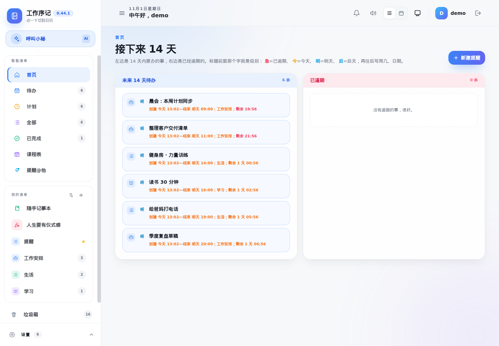
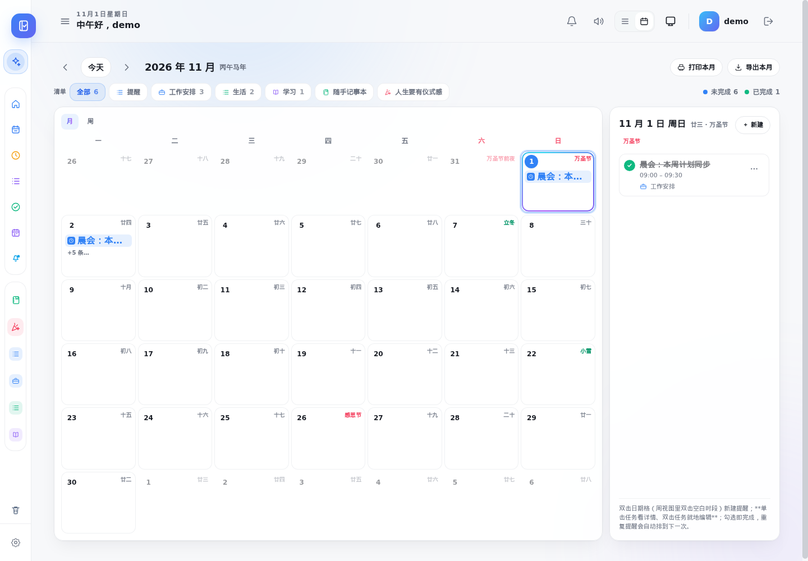
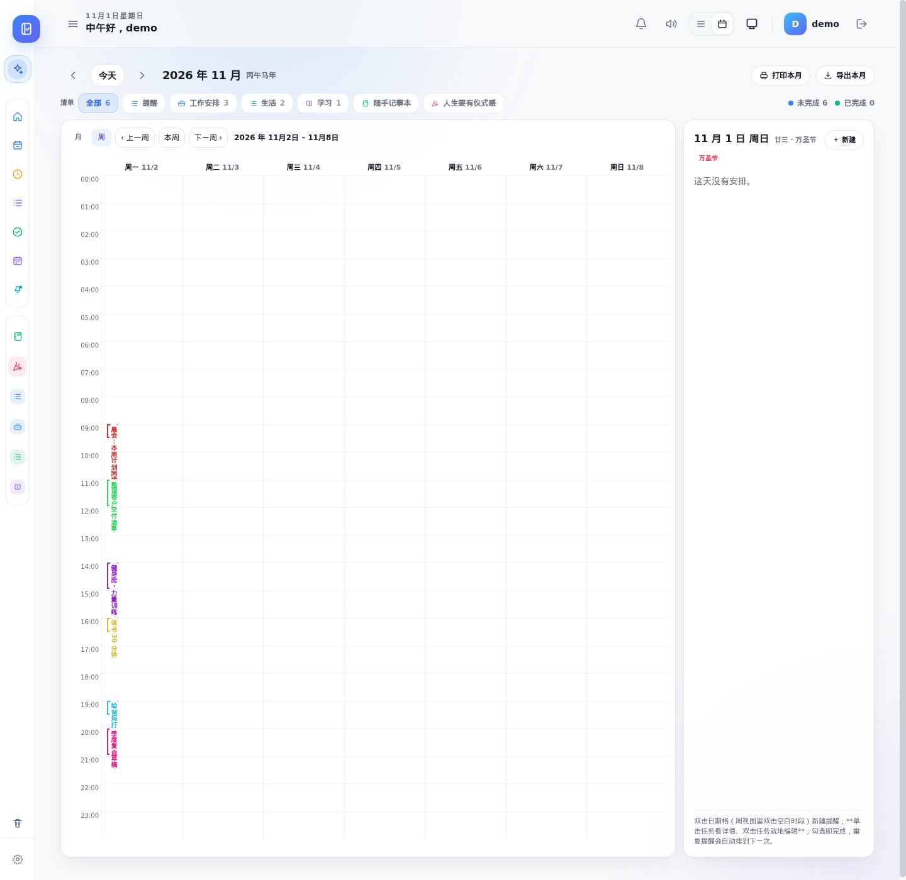
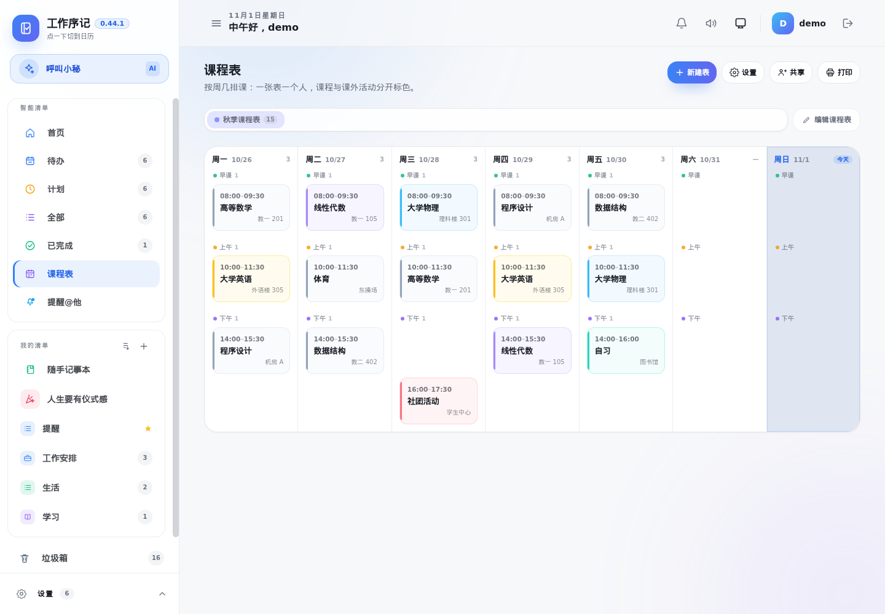
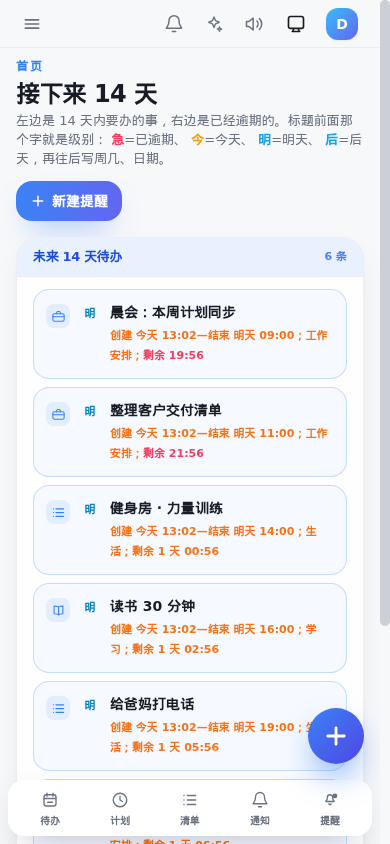
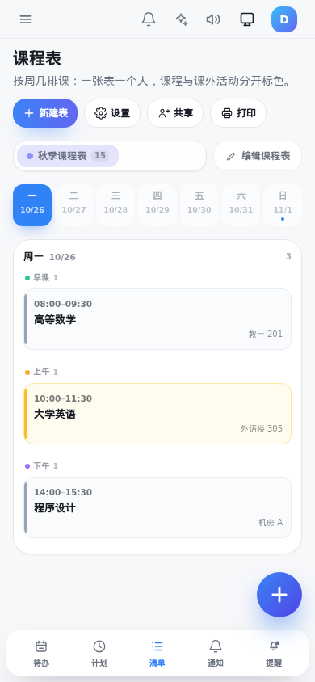

# 工作序记 · WorkOrderNote

任务、记事与日历一体的提醒应用。清单管理、定时提醒、记事归档、月历总览，
支持站内消息、电子邮件、短信、飞书机器人和 QQ 机器人通知。

- 仓库：<http://192.168.3.200:3000/cyberzero/WorkOrderNote>
- 发布与安装包：<http://192.168.3.200:3000/cyberzero/WorkOrderNote/releases>
- GitHub 镜像：<https://github.com/magicindex/workordernote>
- 当前版本：`0.48.0`

> **本项目是衍生作品。** 基于开源项目
> [TechFunWay/reminders](https://github.com/TechFunWay/reminders)（MIT 许可）衍生开发，
> 原项目的著作权与出处均予保留。详见文末「原项目信息」。

---

## 界面预览

| 首页看板 | 月历总览 |
| --- | --- |
|  |  |
| **周视图** | **课程表** |
|  |  |

<p align="center">
  
  &nbsp;&nbsp;
  
</p>

---

## 功能

| 模块 | 说明 |
| --- | --- |
| **任务 / 记事** | 任务需确认完成；记事只作记录，保存即归档、不发送通知；待办卡片显示创建到结束时间 |
| **清单与提醒** | 多清单、优先级、重复提醒（含农历）、逾期提醒、提醒@他、垃圾箱恢复 |
| **视图** | 列表、全屏日历（公历/农历/节气/节日；周视图连续色块、竖排标签、唯一配色、今天流光）、首页看板、倒计时卡片 |
| **课程表** | 按周排课，新一周自动沿用上一周最新课程，已删除课程不带走；课程与课外活动分色，支持打印；手机默认只看今天、日期条切换；可按账号批量共享多张表（只读 / 读写）；课程备注自动收进随手记事本，可按「课程备注」筛选 |
| **随手记事本** | 随手记录，按时间倒序归档，可搜索 |
| **人生要有仪式感** | 生日、纪念日、节日、考试倒计时卡片，公历与农历双行显示（干支年份、彩色日期胶囊，「每年」跟随创建历法）；黑卡/水晶卡面，图标可在编辑里更换，内置节日图标库 |
| **信用卡账单** | 多卡管理，账单日/还款日/额度/本期金额，临近还款日变色提醒；更多菜单点按展开 |
| **通知渠道** | 站内消息、电子邮件、短信、飞书机器人、QQ 机器人；支持免打扰；邮件同时用于找回密码 |
| **AI 小秘** | 桌面端可拖动悬浮球入口（记住位置）、点击展开右侧浮窗且不遮挡正文；接入多家模型服务商，可选模型；基于工作数据回答问题，支持改名 |
| **数据与同步** | 本机/WebDAV 每日自动备份、整库与上传文件恢复、导入导出、双机同步；手机日历只读 ICS 订阅与 .ics 导入；垃圾箱可手动清空或按天数自动清空 |
| **打印** | 日历整月打印，或切换列表按行打印；可调方向、字号、标题与打印列 |
| **多端** | 桌面与手机自适应，支持 PWA 安装；手机底部「提醒」直达提醒@他，悬浮新建按当前频道分流 |

上游自带的能力（到点催办、重复提醒、多邮箱通知、飞牛一键登录等）全部保留。

---

## 最近更新（0.47.1 → 0.48.0）

> 逐条的开发记录在 [`ops/待发布改动.md`](ops/待发布改动.md)，部署记录在
> [`ops/deployment-README.md`](ops/deployment-README.md)。

| 版本 | 迭代内容 | 修的问题 |
| --- | --- | --- |
| 0.47.1 | 「新建备注 / 完成备注」按时间戳拼接：列表已完成行、已完成页、编辑面板、导出都能看到两段 | 新建卡片久置后提交误报「结束时间不能早于现在」（到期时间按提交时刻重算）；logo 与主按钮补纯色兜底底（渐变失效时不再变白块）；导出 CSV 支持单元格内换行 |
| 0.47.2 | 备注真正合成一处：编辑属性里一条可编辑的合并文本（保存时拆回两处），打印新增合并「备注」列且默认勾选 | 编辑面板与打印里两条备注分离、只能编辑一条 |
| 0.47.3 | — | 打开编辑面板还没加载完就按回车会提交空表单，把新建备注清空；现改为未加载完不保存（并从备份恢复了被清空的备注） |
| 0.47.4 | 信用卡分期：只有做了分期的卡显示「分期 第 x/N 期」，已还清不显示；分期弹窗可手工改每期费率（默认官方口径），「保存到卡片」后卡面显示进度 | 原来按开卡月份算的「第 N 期」全部取消（跟分期无关，容易误读） |
| 0.47.5 | — | AI 对话超时只回「Request failed with status code 502」：前端改为显示服务端原因，超时文案带出秒数并提示调大；两台超时 60 → 180 秒（qwen3:8b 写周报实测 90 秒级） |
| 0.47.6 | 文档与发行：README 增加「最近更新」与「边界关系」，补全 CHANGELOG；打 Linux 发行包与新镜像 | 代码无功能性改动 |
| 0.47.7 | — | 新建卡片芯片行的「清空」去掉（它把日期清成空、任务存成无日期），日期只剩相对芯片与「选择日期」两个来源 |
| 0.48.0 | **AI 入口改成桌面悬浮球**：右下角可拖动、拖完记住位置，点击展开右侧浮窗；浮窗不铺遮罩、正文让出等宽槽；窄桌面展开时侧栏自动收成图标栏 | 侧栏「呼叫小秘」占位置、桌面没有可随手拖动的入口；手机端保持原有顶栏图标 + 全屏抽屉不变 |

## 边界关系

本仓库是「工作序记」的应用本体，负责从代码到部署的全部实现。下面说清它改了什么、
不碰什么，以及发版时要同步哪些仓库。

### 本仓库负责（随本仓库提交变化）

| 范围 | 内容 |
| --- | --- |
| 后端 | `server/` Go 服务：提醒/清单、信用卡、课程表、双机同步、备份恢复、AI 助手代理、打印与导出 |
| 前端 | `web/` Vue 3 应用：列表、日历/周视图、首页看板、信用卡、课程表、仪式感、设置与 AI 面板 |
| 构建与部署 | `Dockerfile*`、`docker-compose.yml`、`scripts/`、`ops/`（部署记录、离线包模板、数据校验脚本） |
| 回归测试 | `browser-harness/`（同仓库维护的浏览器用例，随功能同步更新） |
| 发行产物 | `release/`（本地产物，已 git 忽略）、`publish-assets/`（README 截图） |

### 本仓库不负责 / 只读

| 对象 | 关系 |
| --- | --- |
| `reminders-upstream/` | 上游 [TechFunWay/reminders](https://github.com/TechFunWay/reminders) 的只读快照，是衍生的来源；不向上游提交、也不改它 |
| 外部模型服务 | 本机 Ollama（`http://192.168.3.201:11434/v1`）或各云厂商 API，由「系统配置 → AI 助手」配置，不属于本仓库代码 |
| fnOS 系统与统一网关 | 通过 `fnpack/` 打包接入，系统本身不修改 |

### 依赖的其他仓库需要同步什么

| 仓库 / 镜像 | 同步内容 | 触发时机 |
| --- | --- | --- |
| `origin`（Gitea `cyberzero/WorkOrderNote`） | 本仓库全部提交与 tag（主来源） | 每次提交 / 发版 |
| `github`（`magicindex/workordernote`） | 同一个 commit（镜像仓库） | 发版后 `git push github main` |
| GHCR `ghcr.io/magicindex/workordernote` | 镜像 `:<版本>` 与 `:latest` | 发版构建后推送 |
| Gitea Registry `192.168.3.200:3000/cyberzero/workordernote` | 同一镜像（两台生产机从这里拉） | 同上 |
| 两台生产机的 `docker-compose.yml`（`/vol1/1000/Docker/workordernote/`） | 镜像 tag 改为新版本 | 发版时同步 |
| `README.md` / `CHANGELOG.md` / `web/src/data/release-notes.ts` / `ops/deployment-README.md` | 版本号与更新说明 | 每次发版 |

发版标准顺序：改 `VERSION` → 核对四处版本号一致（`VERSION` / `docker-compose.yml` /
`README.md` / `web/src/data/release-notes.ts`）→ 构建镜像 → 推两个 registry →
两台容器拉取重建 → `verify-128` + 双机同步校验 → 写 `ops/deployment-README.md` →
提交并推 `origin` 与 `github`。

## 技术栈

- 后端：Go 1.26 + Gin + GORM + SQLite（CGO）
- 前端：Vue 3 + TypeScript + Vite + Tailwind CSS
- 部署：单二进制或 Docker；数据全部落在本地数据目录

## 快速开始（Docker Compose）

镜像发布在仓库自带的容器仓库，可直接拉取：

```bash
docker pull 192.168.3.200:3000/cyberzero/workordernote:0.48.0
```

同一版本也发布在 GHCR：`ghcr.io/magicindex/workordernote:0.48.0`；Gitea 容器仓库不可用时可直接改用。

### 用仓库里的 compose 文件安装

```bash
mkdir -p ~/workordernote && cd ~/workordernote
curl -fsSLO http://192.168.3.200:3000/cyberzero/WorkOrderNote/raw/branch/main/docker-compose.yml
docker compose up -d
```

从 GitHub 镜像下载同款文件：

```bash
curl -fsSLO https://raw.githubusercontent.com/magicindex/workordernote/main/docker-compose.yml
```

启动后访问 `http://<主机>:8906`，首次打开按页面提示注册管理员账号。

### compose 内容

仓库根目录的 `docker-compose.yml` 已指向当前版本镜像：

```yaml
services:
  workordernote:
    image: 192.168.3.200:3000/cyberzero/workordernote:0.48.0
    container_name: workordernote
    # 数据目录属主是 1000:1001 时必须对齐，否则容器写不进 SQLite 且不报错
    user: "1000:1001"
    ports:
      - "8906:8906"
    volumes:
      - workordernote-data:/app/data
      - /etc/localtime:/etc/localtime:ro
    environment:
      - ENV=release
      - DATA_DIR=/app/data
      - TZ=Asia/Shanghai
    command: ["-data-dir", "/app/data", "-web-dir", "./static/dist", "-log-console"]
    restart: unless-stopped
    labels:
      com.centurylinklabs.watchtower.enable: "false"

volumes:
  workordernote-data:
```

- **数据**：默认存命名卷 `workordernote-data`；想改用本机目录，把 `workordernote-data:/app/data` 换成 `./data:/app/data`，并确保 `user` 与目录属主一致。
- **属主**：`user` 要与数据目录属主一致（常见为 `1000:1001`），否则 SQLite 写入会静默失败。
- **端口**：宿主 8906 被占用时，改 `"8906:8906"` 左侧的端口。
- **watchtower**：若本机运行 watchtower，`watchtower.enable=false` 可避免被上游镜像覆盖。
- **飞牛 NAS**：也可用 Release 里的 `*.fpk` 或离线包安装，无需联网拉镜像。

### 日常操作

```bash
docker compose logs -f        # 查看日志（compose 里已带 -log-console）
docker compose ps             # 查看状态
docker compose down           # 停止并删除容器，数据卷保留
```

升级时，把 compose 里的镜像 tag 改成新版本，再执行：

```bash
docker compose pull && docker compose up -d
```

## 本地开发

```bash
# 构建 Vue 前端、复制到后端静态目录、构建并启动 Go 后端
make dev

# 仅构建
make build

# 跑测试
cd server && go test ./...
```

## 构建 Docker 镜像

上游的 `Dockerfile` 在部分内网环境拉不到 `alpine:3.20`、`npm`/`go` 官方源也不通，
因此本仓库提供了 `Dockerfile.custom`：改用本地可用的 `alpine:latest`（与
`golang:1.26-alpine` 同为 3.24.x，musl ABI 匹配），并把包源换成国内镜像
（apk → mirrors.aliyun.com，npm → registry.npmmirror.com，go → goproxy.cn），
运行阶段的 ca-certificates 与 tzdata 从已有镜像 COPY。

```bash
docker build -f Dockerfile.custom \
  --build-arg VERSION=$(cat VERSION) \
  --build-arg BUILD_TIME=$(date +%Y-%m-%dT%H:%M:%S) \
  --build-arg GIT_COMMIT=$(git rev-parse --short HEAD) \
  -t 192.168.3.200:3000/cyberzero/workordernote:$(cat VERSION) .
```

> tzdata 不是可选项：服务端多处调用 `time.LoadLocation("Asia/Shanghai")`，
> 缺失时返回 `nil`，紧接着的 `now.In(loc)` 会 panic。

## 版本号规则

- **软件版本**：根目录 `VERSION` 文件，格式 `主版本号.小版本号.修正号`。
  对外展示与 `web/src/data/release-notes.ts` 里的迭代说明保持同步。
- **数据库结构版本**：`server/database/Upgrades` 与 `server/reminder/register.go` 里注册的升级条目，
  **只增不改**。继承自上游的 `0.1.2 / 0.3.0 / 0.3.2` 三条保留原编号，
  由 `database.inheritedUpstreamUpgrades` 豁免版本比较——否则切换到本分支后，
  启动时会因「数据库 schema 比程序新」而拒绝服务。

发新版时：改 `VERSION` → 在 `release-notes.ts` 最前面加一条迭代说明 → 如有表结构变更，
在 `register.go` 追加一条 `database.Upgrade`。

## 运行日志

```bash
docker compose logs -f          # 需要 -log-console（compose 示例里已带）
./verify-data.sh                # 数据体检：表数量、行数、integrity_check
```

---

## 回归测试与部署运维

| 目录 | 说明 |
| --- | --- |
| `browser-harness/` | **浏览器回归套件**（39 个套件 / 1000+ 项断言）：登录、列表与日历、信用卡账单、记事本、仪式感卡片、通知弹窗、清单排序、免打扰与逾期提醒、卡片背景图、双机同步、离线包安装……跑之前先 `cd browser-harness && npm install`，用法见该目录的 `README.md` 与 `run-all.sh`。 |
| `ops/` | **部署与发版**：部署记录与逐版本变更、发版台账（`待发布改动.md`）、离线包打包脚本与模板、数据体检脚本。入口见 `ops/README.md`。 |

常用的两条：

```bash
# 全量回归（默认打沙箱 8908；也可指向刚起好的临时容器）
APP_URL=http://127.0.0.1:8908 bash browser-harness/run-all.sh

# 打 Docker 离线一键安装包（默认读仓库 VERSION）
bash ops/build-offline-package.sh
```

---

## 原项目信息

| 项目 | 内容 |
| --- | --- |
| 上游项目 | [TechFunWay/reminders](https://github.com/TechFunWay/reminders) |
| 上游作者 | 科技智趣坊（TechFunWay） |
| 许可 | MIT License，见 [LICENSE](LICENSE) |
| 本项目 | WorkOrderNote（工作序记），基于上游衍生开发 |

本衍生作品遵循上游的 MIT 许可，保留原始版权声明；上游项目名称、作者与链接
均如实标注，未作删改。上游的能力与设计成果归原作者所有。
